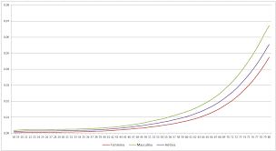

# mortalityAdherence 

<!-- badges: start -->
[](https://github.com/eduardoflm/mortalityAdherence/actions/workflows/R-CMD-check.yaml)
[](https://app.codecov.io/gh/eduardoflm/mortalityAdherence?branch=main)
[](https://opensource.org/licenses/MIT)
[](https://www.r-project.org/)
<!-- badges: end -->

> **Statistical Validation of Mortality/Annuity Tables for Pension Funds**

`mortalityAdherence` is an R package for actuaries who need to assess whether a
biometric mortality/annuity table is statistically consistent with the observed experience
data of a pension fund. It implements **11 statistical tests**, ships with
**10 built-in mortality tables**, and produces clean, formatted results suitable
for actuarial reports and regulatory submissions.

---

## Python version

The same 11 tests are also available in **Python** (folder [`python/`](python/)), with the
same function names. No R or Git needed:

```bash
pip install "mortalityAdherence @ https://github.com/eduardoflm/mortalityAdherence/archive/refs/heads/main.zip#subdirectory=python"
```

[](https://colab.research.google.com/github/eduardoflm/mortalityAdherence/blob/main/python/examples/quickstart.ipynb)
— try it in the browser, without installing anything. See [`python/README.md`](python/README.md).

---

## Installation (R)

```r
install.packages("remotes")
remotes::install_url(
  "https://github.com/eduardoflm/mortalityAdherence/archive/refs/heads/main.zip"
)

# Optional: read Excel files and export results to Excel
install.packages(c("readxl", "writexl"))
```

---

## Quick Start

```r
library(mortalityAdherence)

# 1. See available built-in tables
listTables()

# 2. Load your pension fund data (CSV, Excel, or data.frame)
fund_data <- loadFundData("experience.csv",
                           col_age = "Age", col_exposed = "Exposed",
                           col_deaths = "Deaths")

# 3. Run all 11 adherence tests
result <- testAdherence(fund_data, table = "AT-2000m", alpha = 0.05)

# 4. Display results
print(result)
result$summary
```

---

## The 11 Statistical Tests

```
┌─────────────────────────────────────────────────────────────────┐
│                  11 ADHERENCE TESTS                             │
├──────────────────────┬──────────────────────────────────────────┤
│ Non-parametric       │  KS  ·  ChiSquare                        │
├──────────────────────┼──────────────────────────────────────────┤
│ Poisson — Type I     │  WaldI_P  ·  LRTI_P  (closed-form)       │
│ Poisson — Type II    │  WaldII_P  ·  LRTII_P  (GLM + slope)     │
│ Bayesian             │  BayesCI  (Gamma-Poisson conjugate)      │
├──────────────────────┼──────────────────────────────────────────┤
│ Negative Binomial    │  WaldI_NB  ·  WaldII_NB                  │
│ (overdispersion)     │  LRTI_NB  ·  LRTII_NB                    │
└──────────────────────┴──────────────────────────────────────────┘
```

### Type I vs Type II

| | Detects |
|---|---|
| **Type I** | Overall level mismatch (global A/E deviation) |
| **Type II** | Age-systematic bias (slope in observed vs expected by age) |

### When to use NB tests

Use Negative Binomial tests when your fund has fewer than ~5,000 members,
shows mortality clustering, or when the Poisson dispersion test is significant.

---

## Built-in Mortality Tables

| Table | Description |
|---|---|
| `AT-2000bm` | American Table 2000 — Male Basic (SOA) |
| `AT-2000m`  | American Table 2000 — Male (SOA) |
| `AT-49M`    | American Table 1949 — Male |
| `AT-55m`    | American Table 1955 — Male |
| `AT-83ms`   | American Table 1983 — Male (smoothed) |
| `GAM71m`    | Group Annuity Mortality 1971 — Male (SOA) |
| `GAM83m`    | Group Annuity Mortality 1983 — Male (SOA) |
| `BR-EMS2010`| Brazilian Insur. Mortality Experience 2010 |
| `BR-EMS2015`| Brazilian Insur. Mortality Experience 2015 |
| `BR-EMS2021`| Brazilian Insur. Mortality Experience 2021 |

All tables cover ages **0 – 120** and express annual death probabilities \(q_x\).

---

## Example Output

Synthetic fund, 5 years stacked (255 cells), deaths generated from AT-2000m with
overdispersion. The chi-squared test rejects the correct table, as documented in
the paper; the proposed tests do not.

```
====================================================================================================
  mortalityAdherence :: Biometric Table Adherence Test
====================================================================================================
  Mortality table    : AT-2000m
  Significance level : 5.0%
  Cells (rows)       : 255
  Unique ages        : 51
  Years              : 5
  Total exposed      : 21,847
  Observed deaths (D): 547
  Expected deaths (Q): 540.65
  A/E ratio (D/Q)    : 1.0118  (+1.2%)
  Dispersion ratio   : 1.4186 -- overdispersion present, NB tests applied
  Min. detectable    : theta < 0.89 or theta > 1.13 (80% power, version I tests)
----------------------------------------------------------------------------------------------------
  Test         Description                                 Statistic     P-value  Decision
----------------------------------------------------------------------------------------------------
  [ Non-parametric ]
  KS           Kolmogorov-Smirnov                             0.0355    0.487559  [  pass  ]
                 -> Critical value = 0.0578 (p-value approx.)
  ChiSquare    Chi-Square Goodness-of-Fit                   364.6225    0.000006  [ REJECT ]
                 -> df = 254 (k-1); 139 of 255 cells with expected deaths < 1
  [ Poisson ]
  WaldI_P      Wald Type I (Poisson)                          0.2733    0.784620  [  pass  ]
  WaldII_P     Wald Type II - age slope (Poisson)             0.1740    0.916691  [  pass  ]
  LRTI_P       LRT Type I (Poisson)                           0.0744    0.785029  [  pass  ]
  LRTII_P      LRT Type II - age slope (Poisson)              0.1719    0.917644  [  pass  ]
  [ Bayesian ]
  BayesCI      Bayesian Credible Interval                         --    0.792028  [  pass  ]
                 -> 95% CI: [0.9291, 1.0983]; posterior tail prob.
  [ Negative Binomial ]
  WaldI_NB     Wald Type I (Negative Binomial)                0.4585    0.646598  [  pass  ]
                 -> phi = 6.28
  WaldII_NB    Wald Type II - age slope (Neg. Binomial)       0.2287    0.891945  [  pass  ]
                 -> phi = 6.28
  LRTI_NB      LRT Type I (Negative Binomial)                 0.2089    0.647666  [  pass  ]
                 -> phi = 6.28
  LRTII_NB     LRT Type II - age slope (Neg. Binomial)        0.2266    0.892872  [  pass  ]
                 -> phi = 6.28
====================================================================================================
  1 of 11 applicable tests reject H0 at the 5% significance level.
  [!!] PARTIAL ADHERENCE: some tests failed. Review critical age groups.
  Note: a non-rejection only rules out deflators outside [0.89, 1.13] (80% power); smaller departures may go undetected (paper, eq. 17).
  Reference: de Melo, Graziadei & Targino (2026), SSRN 6668699.
```

---

## Rules from the paper implemented in the package

* **No deaths in the sample (D = 0):** Wald tests (versions I and II, Poisson and
  Negative Binomial) are not applicable and are reported as `N/A`; the LRT tests
  remain valid, with statistic 2Q (Sec. 3.5).
* **Minimum detectable deflator** (eq. 17) reported with every result: in a small
  fund a non-rejection may only mean that the fund is too small to tell.
* **KS** computed on the age margins (eq. 2); it is invariant to the overall level
  of mortality (Sec. 3.6).
* **Bayesian CI:** empirical-Bayes prior from the age-specific ratios; the `p_value`
  column holds the posterior tail probability (eq. 10).
* **Chi-squared:** `k-1` degrees of freedom by default (practice); `chisq_df = "k"`
  gives the correct reference distribution for a fixed table (Sec. 2.1).
* **Negative Binomial:** skipped with a message when there is no overdispersion
  (dispersion ratio <= 1); `skip_nb_if_no_overdispersion = FALSE` runs them anyway.

---

## Custom Tables

```r
# Apply a longevity improvement factor of 0.90
adjusted <- loadTable("AT-2000m")
adjusted$qx <- adjusted$qx * 0.90

result <- testAdherence(fund_data, table = adjusted)
```

---

## HTML and Excel Output

```r
htmlTable(result, path = "results.html")   # styled HTML page (rendered directly in R Markdown)
exportExcel(result, "results.xlsx")         # sheets: Tests, Overview, Data used (needs writexl)
```

---

## API Reference

| Function | Description |
|---|---|
| `testAdherence(data, table, alpha)` | Run all 11 tests; returns `adherence_result` |
| `listTables()` | Data frame catalogue of built-in tables |
| `loadTable(name)` | Retrieve a built-in table as `data.frame(age, qx)` |
| `loadFundData(file, ...)` | Read CSV/Excel fund experience data |
| `printResult(x)` | Formatted console output |
| `htmlTable(x, path)` | Styled HTML table (file or R Markdown) |
| `exportExcel(x, path)` | Excel file with tests, overview and data used |
| `mortality_tables` | Built-in dataset (all 10 tables, ages 0–120) |

---

## Contributing

Contributions are welcome. Please open an issue to discuss proposed changes
before submitting a pull request. All PRs must pass `R CMD CHECK` with no
errors or warnings.

---

## Citation

If you use `mortalityAdherence` in your work, please cite the underlying research paper:

```bibtex
@article{deMelo2026,
  author    = {de Melo, Eduardo Fraga L. and Graziadei, Helton and Targino, Rodrigo},
  title     = {Annuity Table Validation in Pension Funds: A Comparative Power
               Analysis of Goodness-of-Fit Tests},
  year      = {2026},
  month     = {April},
  note      = {SSRN Working Paper},
  url       = {https://papers.ssrn.com/sol3/papers.cfm?abstract_id=6668699},
  pages     = {27}
}
```

Or in plain text:

> de Melo, E.F.L., Graziadei, H. & Targino, R. (2026). *Annuity Table Validation
> in Pension Funds: A Comparative Power Analysis of Goodness-of-Fit Tests.*
> SSRN Working Paper. https://papers.ssrn.com/sol3/papers.cfm?abstract_id=6668699

---

## License

MIT © 2026 mortalityAdherence authors — see [LICENSE](LICENSE) for details.

---

## References

> ### 📄 Primary Reference — Please cite this paper when using mortalityAdherence
>
> **de Melo, E.F.L., Graziadei, H. & Targino, R. (2026).**
> *Annuity Table Validation in Pension Funds: A Comparative Power Analysis of Goodness-of-Fit Tests.*
> SSRN Working Paper. 27 pages. Posted: 28 Apr 2026.
> [https://papers.ssrn.com/sol3/papers.cfm?abstract_id=6668699](https://papers.ssrn.com/sol3/papers.cfm?abstract_id=6668699)
>
> *Affiliations: Universidade do Estado do Rio de Janeiro (UERJ);
> Getulio Vargas Foundation (FGV) — EMAp — School of Applied Mathematics;
> Superintendence of Private Insurance (SUSEP);
> Federal University at Sao Carlos - UFSCar.*

---

### Additional References

- Bowers, N.L. et al. (1997). *Actuarial Mathematics*, 2nd ed. Society of Actuaries.
- Benjamin, B. & Pollard, J.H. (1993). *The Analysis of Mortality and Other Actuarial Statistics*. IoFA.
- London, D. (1985). *Survival Models and Their Estimation*. ACTEX Publications.
- FenaPrevi (2021). *Tábua BR-EMS2021*. Brazil.
